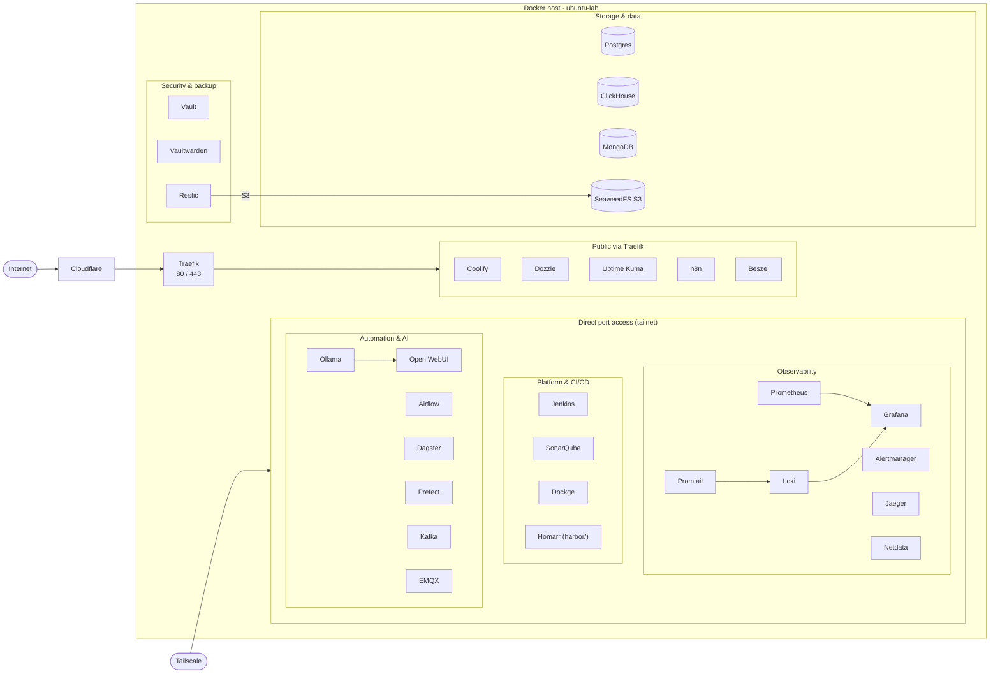

<div align="center">

# 🧪 Homelab

**Self-hosted infrastructure as code — 43 independent Docker Compose stacks.**

Monitoring · CI/CD · Automation & AI · Data engineering · Storage · Security · Developer tools


</div>

---

## Table of Contents

- [Overview](#overview)
- [Architecture](#architecture)
- [Service Catalog](#service-catalog)
- [Ports Overview](#ports-overview)
- [Requirements](#requirements)
- [Getting Started](#getting-started)
- [Deployment](#deployment)
- [Configuration](#configuration)
- [Quick Links](#quick-links)
- [Repository Layout](#repository-layout)
- [Operational Notes](#operational-notes)
- [Roadmap](#roadmap)
- [Contributing](#contributing)

## Overview

This repository is the source of truth for the stacks running on a single Docker host (`ubuntu-lab`, a VPS). Each top-level directory is a **standalone Compose stack** with its own config, `.env.example` and (where needed) its own bridge network. There is no application code to build — changes are Compose and config edits.

**Design principles**

| Principle | What it means here |
|-----------|--------------------|
| Independent stacks | Start, stop and update any service without touching the others |
| Pinned versions | Images use explicit tags, never `:latest` (known exceptions are listed in [Operational Notes](#operational-notes)) |
| Secrets stay out of git | `.env`, keys, certificates and data directories are gitignored; only `.env.example` is committed |
| Private by default | Admin tools are reached over Tailscale; only selected services are public through Traefik + Cloudflare |

## Architecture



> **Network note.** Each stack defines its **own** bridge network (`proxy`, `homelab`, `llm_net`, `seaweed_net`, `sonarnet`, `jenkins_network`, `dagster_net`, `prefect_net`, `kafka_net`, `loki_net`, `alertmanager_net`, `jaeger_net`, `vault_net`, `restic_net`) and a few share the external network `homelab_net`. There is no shared convention — check the target compose file before wiring services together.

## Service Catalog

Every service links to its directory. Hostnames use the `jeerasakananta.dev` domain; everything else is reachable on its host port.

### Monitoring & Observability

| Service | Purpose | Port | Notes |
|---------|---------|------|-------|
| [Glance](glance/) | Dashboard with service status and Docker widget | `${GLANCE_PORT:-8080}` | |
| [Homepage](homepage/) | Start page for all services | `3030` | Proxmox / Grafana integrations via env |
| [Grafana](grafana/) | Visualization and dashboards | `3080` | Admin credentials, domain and root URL in compose env |
| [Prometheus](prometheus/) | Metrics and time-series DB | `9090` | Scrape config: `prometheus/prometheus.yml` |
| [Netdata](netdata/) | Real-time host metrics | `19999` | Host network mode |
| [Beszel](beszel/) | Lightweight host monitoring (hub + agent) | `${BESZEL_PORT:-8090}` | Agent talks to the hub over a Unix socket — see below |
| [Uptime Kuma](kuma/) | Uptime and status monitoring | `${KUMA_PORT:-3001}` | `https://kuma.jeerasakananta.dev` |
| [Dozzle](dozzle/) | Live Docker log viewer | `${DOZZLE_PORT:-8080}` | Simple auth; users created in the web UI |
| [Loki](loki/) + Promtail | Log aggregation | `3100` / `9080` | 7-day retention; add `http://loki:3100` as a Grafana datasource |
| [Alertmanager](alertmanager/) | Alert routing | `9093` | Telegram receiver; template in `alertmanager/templates/` |
| [Jaeger](jaeger/) | Distributed tracing | `16686`, `4317/4318` | Badger storage; OTLP endpoint `http://jaeger:4318/v1/traces` |
| [Log Generator](log-generator/) | Fake logs for testing pipelines | — | No ports; 5 MB × 2 log rotation |

> **Beszel hub/agent.** `beszel/docker-compose.yaml` shares a `beszel_socket` volume between hub and agent. When registering this host in the hub UI, set **Host / IP** to the socket path `/beszel_socket/beszel.sock` — not an IP or `localhost`.

### Platform & CI/CD

| Service | Purpose | Port | Notes |
|---------|---------|------|-------|
| [Coolify](coolify/) | Self-hosted PaaS | — | `https://api-homelab.jeerasakananta.dev/coolify` via Traefik (strip-prefix); network `homelab_net` |
| [Dockge](dockge/) | Compose stack manager | `5001` | |
| [Jenkins](jenkins/) | CI/CD server | `8888`, `50000` | Privileged, Docker socket access |
| [SonarQube](sonarqube/) | Static analysis | `${SONAR_PORT:-9000}` | Dedicated Postgres; 4 GB limit |
| [Nginx Proxy Manager](nginx-proxy-manager/) | Proxy hosts and certificates GUI | `80`, `81`, `443` | Network `homelab_net` |
| [Homarr](harbor/) | Dashboard (directory is named `harbor/`, **not** the Harbor registry) | `7575` | Needs `SECRET_ENCRYPTION_KEY` |

### Automation & AI

| Service | Purpose | Port | Notes |
|---------|---------|------|-------|
| [n8n](n8n/) | Workflow automation | `5678` | `https://n8n.jeerasakananta.dev` |
| [Ollama](ollama/) | Local LLM runtime | internal `11434` | No host port; optional NVIDIA GPU |
| [Open WebUI](openwebui/) | Chat UI for Ollama | `8080` | |
| [EMQX](emqx/) | MQTT broker | `1883`, `8883`, `8083`, `8084`, `18083` | Dashboard on `18083` |
| [Home Assistant](homeassistant/) | Home automation | host | Host network mode |
| [JupyterLab](jupyterlab/) | Notebook server | `8888` | Token from `${JUPYTER_TOKEN}` |
| [Airflow](airflow/) | Workflow scheduler (LocalExecutor) | `${AIRFLOW_WEB_PORT:-8088}` | Needs `airflow-init` on first run |

### Data Engineering & Orchestration

| Service | Purpose | Port | Notes |
|---------|---------|------|-------|
| [Dagster](dagster/) | Asset-based orchestrator | `${DAGSTER_WEB_PORT:-3070}` | Webserver + daemon + code location + Postgres |
| [Prefect](prefect/) | Python-native orchestrator | `${PREFECT_WEB_PORT:-4200}` | Prefect 3 server + Postgres |
| [Kafka](kafka/) | Single-broker Kafka (KRaft) + Redpanda Console | `9092`, `8085` | Set `KAFKA_ADVERTISED_HOST` for off-host clients |

### Storage & Data

| Service | Purpose | Port | Notes |
|---------|---------|------|-------|
| [SeaweedFS](seaweedfs/) | Object storage with S3 API | `9333`, `8080`, `8888`, `8333` | Usage examples in [seaweedfs/README.md](seaweedfs/README.md) |
| [Postgres](postgres/) | Shared PostgreSQL 18 + pgAdmin | `${DB_PORT}`, `${PGADMIN_PORT:-5050}` | Network `homelab_net`; init script runs on first init only |
| [ClickHouse](clickhouse/) | Columnar OLAP database | `8123`, `9000`, `9004`, `9005` | Default `admin`/`admin` — change before exposing |
| [MongoDB](mongodb/) | Document DB + Mongo Express | `27017`, `8081` | Separate DB and UI credentials |
| [Syncthing](syncthing/) | P2P file synchronization | `8384`, `22000`, `21027` | Runs as UID 1000 — see [Setup notes](#per-stack-setup-notes) |
| [openGym](opengym/) | Workout tracker (passkeys, sync, PWA) | `${WEB_PORT:-8095}` | Needs HTTPS on its `RP_ID` host for passkeys |
| [Navidrome](navidrome/) | Music streaming server | `${ND_PORT:-4533}` | Library mounted read-only from `MUSIC_PATH` |
| [Music](music/) | Navidrome **+** MeTube downloader bundle | `${ND_PORT}`, `8081` | Overlaps `navidrome/`; MeTube's `8081` collides with Mongo Express |

### Developer Tools

| Service | Purpose | Port | Notes |
|---------|---------|------|-------|
| [code-server](vscodeserver/) | VS Code in the browser | `8443` | `CODE_SERVER_PASSWORD`, `PUID`, `PGID` |
| [Excalidraw](excalidraw/) | Whiteboard | `3000` | |

### Security & Backup

| Service | Purpose | Port | Notes |
|---------|---------|------|-------|
| [Vaultwarden](vaultwarden/) | Bitwarden-compatible password manager | `${APP_PORT}`, `${WEBSOCKET_PORT}` | Data in `./vw-data`; set `ADMIN_TOKEN` |
| [HashiCorp Vault](vault/) | Secrets management | `8200` | **Dev mode** (in-memory) — use raft + auto-unseal for production |
| [Restic](restic/) | Scheduled backups to S3 | — | Daily 02:00 · prune Sun 04:00 · check Sun 06:00; keeps 7d/4w/6m/1y |

### Networking & Reverse Proxy

| Service | Purpose | Port | Notes |
|---------|---------|------|-------|
| [Traefik](traefik/) | Reverse proxy with Let's Encrypt | `80`, `443`, `8080` | Network `proxy`; `acme.json` must be `chmod 600` |
| [Nginx](nginx/) | TLS-terminating web server | `80`, `443` | Network `homelab_net` |

**Traefik routing pattern.** Proxied services use path-prefix routing on a single hostname. [coolify/docker-compose.yaml](coolify/docker-compose.yaml) is the reference:

```yaml
labels:
  - "traefik.enable=true"
  - "traefik.http.routers.<name>.rule=Host(`api-homelab.jeerasakananta.dev`) && PathPrefix(`/<name>`)"
  - "traefik.http.routers.<name>.entrypoints=websecure"
  - "traefik.http.routers.<name>.tls.certresolver=cloudflare"
  - "traefik.http.middlewares.<name>-strip.stripprefix.prefixes=/<name>"
  - "traefik.http.routers.<name>.middlewares=<name>-strip"
```

## Ports Overview

| Service | Host port | Container port | Network |
|---------|-----------|----------------|---------|
| Traefik | 80, 443, 8080 | 80, 443, 8080 | `proxy` |
| Nginx | 80, 443 | 80, 443 | `homelab_net` |
| Nginx Proxy Manager | 80, 81, 443 | 80, 81, 443 | `homelab_net` |
| Glance | 8080 | 8080 | `homelab` |
| Dozzle | 8080 | 8080 | — |
| Open WebUI | 8080 | 8080 | — |
| SeaweedFS Volume | 8080 | 8080 | `seaweed_net` |
| Grafana | 3080 | 3000 | — |
| Homepage | 3030 | 3000 | `homelab` |
| Excalidraw | 3000 | 80 | — |
| Dagster | 3070 | 3000 | `dagster_net` |
| Uptime Kuma | 3001 | 3001 | `homelab` |
| Netdata | 19999 | 19999 | host |
| Prometheus | 9090 | 9090 | — |
| Loki / Promtail | 3100 / 9080 | 3100 / 9080 | `loki_net` |
| Alertmanager | 9093 | 9093 | `alertmanager_net` |
| Jaeger | 16686, 4317, 4318, 14268, 6831/6832 | same | `jaeger_net` |
| Beszel Hub | 8090 | 8090 | — |
| openGym | 8095 | 80 | — |
| Navidrome | 4533 | 4533 | — |
| Homarr (`harbor/`) | 7575 | 7575 | — |
| Dockge | 5001 | 5001 | — |
| Jenkins | 8888, 50000 | 8080, 50000 | `jenkins_network` |
| JupyterLab | 8888 | 8888 | — |
| SeaweedFS Filer | 8888 | 8888 | `seaweed_net` |
| SonarQube | 9000 | 9000 | `sonarnet` |
| n8n | 5678 | 5678 | — |
| Prefect | 4200 | 4200 | `prefect_net` |
| Kafka / Redpanda Console | 9092 / 8085 | 9092 / 8080 | `kafka_net` |
| Airflow | 8088 | 8080 | — |
| Ollama | — | 11434 | `llm_net` (internal) |
| EMQX | 1883, 8883, 8083, 8084, 18083 | same | — |
| Home Assistant | host | — | host |
| SeaweedFS Master / S3 | 9333 / 8333 | 9333 / 8333 | `seaweed_net` |
| Postgres | `${DB_PORT}` | 5432 | `homelab_net` |
| pgAdmin | `${PGADMIN_PORT:-5050}` | 80 | `homelab_net` |
| ClickHouse | 8123, 9000, 9004, 9005 | same | — |
| MongoDB / Mongo Express | 27017 / 8081 | 27017 / 8081 | — |
| MeTube (`music/`) | 8081 | 8081 | — |
| Syncthing | 8384, 22000, 21027 | same | — |
| code-server | 8443 | 8443 | — |
| Vaultwarden | `${APP_PORT}`, `${WEBSOCKET_PORT}` | 80, 3012 | — |
| Vault | 8200 | 8200 | `vault_net` |
| Restic | — | — | `restic_net` |

> **⚠️ Port conflicts.** `8080` is the default for Glance, Dozzle, Open WebUI, Traefik and the SeaweedFS volume server; `8888` is shared by Jenkins, JupyterLab and the SeaweedFS filer; `8081` by Mongo Express and MeTube. Use the `.env` overrides before running these on the same host.

## Requirements

- Docker Engine with the Compose v2 plugin (`docker compose`)
- Tailscale — private access to the `0.0.0.0`-bound admin tools
- Cloudflare account and `cloudflared` / DNS — public HTTPS through Traefik
- `iptables-persistent` (`netfilter-persistent`) — blocks database ports via the `DOCKER-USER` chain

## Getting Started

```bash
git clone https://github.com/JeerasakAnanta/homelab.git
cd homelab

# External networks shared by a few stacks (create once)
docker network create proxy
docker network create homelab_net
```

Start any stack on its own:

```bash
cd <service>
cp .env.example .env          # only for stacks that ship an .env.example
docker compose config -q      # validate without starting
docker compose up -d
```

Most stacks use `docker-compose.yaml`. `dozzle`, `nginx` and `vaultwarden` use `compose.yaml`: `docker compose -f compose.yaml up -d`.

**Suggested start order:** `traefik` → `postgres` → monitoring (`prometheus`, `grafana`, `loki`, `alertmanager`, `kuma`, `beszel`) → everything else. Stacks that ship an `.env.example` to copy: `airflow`, `alertmanager`, `beszel`, `dagster`, `dozzle`, `glance`, `homepage`, `kafka`, `kuma`, `mongodb`, `n8n`, `navidrome`, `opengym`, `prefect`, `restic`, `seaweedfs`, `sonarqube`, `syncthing`, `vault`. Others (`grafana`, `postgres`, `vaultwarden`, `vscodeserver`, `jupyterlab`, `harbor`) read variables from inline compose env or a hand-written `.env` — see their compose file.

### Per-stack setup notes

| Stack | Before the first start |
|-------|------------------------|
| `traefik` | `touch acme.json && chmod 600 acme.json` |
| `airflow` | `mkdir -p dags logs plugins config`, `chown -R 50000:0` them, then `docker compose up airflow-init` before `up -d` |
| `dagster` | `docker compose build` (custom code-location image) |
| `seaweedfs` | `cp .env.example .env && cp s3.json.example s3.json` and edit both (`s3.json` is gitignored) |
| `syncthing` | `mkdir -p config data && sudo chown -R 1000:1000 config data` — the container runs as UID 1000 and cannot chown its own volumes |
| `vault` | `docker compose exec vault /vault/init/vault-init.sh` after start (KV v2, database engine, policies) |
| `restic` | Set `S3_ENDPOINT`, `S3_BUCKET`, AWS credentials and `RESTIC_PASSWORD` — **keep the password safe**, snapshots cannot be decrypted without it |
| `kafka` | Set `KAFKA_ADVERTISED_HOST` to the host address for off-host clients |
| `opengym` | Set `RP_ID` / `ORIGIN` to the real HTTPS hostname; register your own profile first (first user becomes admin), then enable `INVITE_ONLY=1` |
| `harbor` (Homarr) | Create `.env` with `SECRET_ENCRYPTION_KEY` from `openssl rand -hex 32` |

## Deployment

The host runs these stacks two ways. A change only takes effect through whichever path the service actually uses.

| Path | How it works | Where variables live |
|------|--------------|----------------------|
| **DockHand** (primary) | Git-syncs this repo from GitHub and redeploys a stack from its compose path (e.g. `beszel/docker-compose.yaml`) | Entered in **DockHand's per-stack UI**; the repo's `.env.example` only documents names and shapes |
| **Manual** | `docker compose up -d` from the service directory | `.env` next to the compose file |

> Editing `.env` in the repo does **not** change a DockHand-managed stack — update the variable in DockHand's UI.

**Reaching the host.** The server is reachable over Tailscale (`homelab-ts`) and its public IP (`homelab-pub`); aliases are in `~/.ssh/config`. Admin tools (Beszel, Dozzle, Syncthing GUI, SonarQube, …) deliberately bind `0.0.0.0` so they are reachable over the tailnet — do not change them to `127.0.0.1` without checking that it is not their only access path.

## Configuration

Config lives next to each compose file. Bind-mounted data directories and all secrets are gitignored.

| Service | Configuration | Notes |
|---------|---------------|-------|
| Glance | `glance/config/`, `glance/assets/` | Dashboard YAML |
| Grafana | `grafana/.env` / compose env | Admin credentials, domain, root URL |
| Prometheus | `prometheus/prometheus.yml` | Scrape targets and rules |
| Netdata | `netdata/netdataconfig/` | |
| Homepage | `homepage/.env` | Proxmox and Grafana credentials |
| Beszel | `beszel/.env` | `BESZEL_TOKEN` / `BESZEL_KEY` from the hub's "Add System" dialog |
| Uptime Kuma | `kuma/.env` | `KUMA_VERSION`, `KUMA_PORT` |
| Dozzle | `dozzle/.env` | `DOZZLE_PORT` |
| Loki | `loki/config/` | `loki-local-config.yaml`, `promtail-config.yaml` |
| Alertmanager | `alertmanager/config/`, `alertmanager/templates/` | `alertmanager.yml`, Telegram template |
| Jaeger | compose | Badger storage, OTLP enabled |
| SonarQube | `sonarqube/.env` | |
| n8n | `n8n/.env` | |
| Airflow | `airflow/.env` | Fernet key, admin password, extra pip requirements |
| JupyterLab | `jupyterlab/.env` | `JUPYTER_TOKEN` |
| Dagster | `dagster/.env`, `dagster.yaml`, `workspace.yaml` | Postgres credentials, web port |
| Prefect | `prefect/.env`, `prefect/flows/` | Postgres credentials, web port |
| Kafka | `kafka/.env` | `KAFKA_ADVERTISED_HOST`, console port, cluster ID |
| Postgres | `postgres/.env` | DB name, user, password, port, pgAdmin login + port |
| Postgres | `postgres/.env` | DB name, user, password, port |
| MongoDB | `mongodb/.env` | Root and Mongo Express credentials, init DB |
| ClickHouse | compose | Default `admin`/`admin` — change |
| Syncthing | `syncthing/.env` | `GUI_BIND`, `GUI_PORT`, `SYNC_PORT`, `DISCOVERY_PORT`, `TZ` |
| openGym | `opengym/.env` | `WEB_PORT`, `RP_ID`, `ORIGIN`, `FIRST_USER_ADMIN`, `INVITE_ONLY` |
| Navidrome | `navidrome/.env` | `ND_PORT`, `MUSIC_PATH`, `ND_UID`/`ND_GID` |
| code-server | `vscodeserver/.env` | `PUID`, `PGID`, `TZ`, `CODE_SERVER_PASSWORD` |
| Vaultwarden | `vaultwarden/.env` | `DOMAIN`, ports, `ADMIN_TOKEN`, `SIGNUPS_ALLOWED` |
| Vault | `vault/config/vault.hcl`, `vault/init/vault-init.sh` | Root token via `VAULT_ROOT_TOKEN` |
| Restic | `restic/config/restic-exclude.txt`, `restic/scripts/` | Exclude patterns, backup/prune/check scripts |
| Traefik | `traefik/traefik.yml`, `traefik/config/dynamic.yml`, `traefik/acme.json` | Static/dynamic config, certificates |
| Nginx | `nginx/conf.d/`, `nginx/certs/`, `nginx/logs/` | Server blocks, TLS certificates |

## Quick Links

| Service | URL |
|---------|-----|
| Uptime Kuma | `https://kuma.jeerasakananta.dev` |
| Beszel | `https://beszel.jeerasakananta.dev` |
| Dozzle | `https://dozzle.jeerasakananta.dev` (or `http://<host>:8080`) |
| n8n | `https://n8n.jeerasakananta.dev` |
| Coolify | `https://api-homelab.jeerasakananta.dev/coolify` |
| Vaultwarden | `https://<DOMAIN>` |
| Traefik dashboard | `http://<host>:8080` |
| Glance | `http://<host>:8080` |
| Grafana | `http://<host>:3080` |
| Prometheus | `http://<host>:9090` |
| Netdata | `http://<host>:19999` |
| Homepage | `http://<host>:3030` |
| Alertmanager | `http://<host>:9093` |
| Jaeger | `http://<host>:16686` |
| Loki | `http://<host>:3100` |
| Dockge | `http://<host>:5001` |
| Jenkins | `http://<host>:8888` |
| SonarQube | `http://<host>:9000` |
| Nginx Proxy Manager | `http://<host>:81` |
| Homarr | `http://<host>:7575` |
| Open WebUI | `http://<host>:8080` |
| EMQX dashboard | `http://<host>:18083` |
| Airflow | `http://<host>:8088` |
| Dagster | `http://<host>:3070` |
| Prefect | `http://<host>:4200` |
| Redpanda Console | `http://<host>:8085` |
| JupyterLab | `http://<host>:8888` |
| SeaweedFS Filer | `http://<host>:8888` |
| Mongo Express | `http://<host>:8081` |
| Syncthing | `http://<host>:8384` |
| Navidrome | `http://<host>:4533` |
| openGym | `http://<host>:8095` (HTTPS required for passkeys) |
| code-server | `https://<host>:8443` |
| Excalidraw | `http://<host>:3000` |
| Vault | `http://<host>:8200` |

## Repository Layout

```text
homelab/
├── <service>/            # one directory per stack
│   ├── docker-compose.yaml   # (or compose.yaml)
│   ├── .env.example          # documents variables; real .env is gitignored
│   └── config/ ...           # per-service configuration
├── ansible/              # inventory and playbooks for host setup
├── docs/                 # agent docs (issue tracker, triage labels) and design specs
├── CLAUDE.md             # guidance for Claude Code
└── README.md
```

`promtail/` and `data/` carry no compose file of their own (Promtail ships with the `loki/` stack).

## Operational Notes

- **Pin image versions.** Never use `:latest` (rationale in `dozzle/compose.yaml`). Known exceptions, where upstream publishes no stable tags: `jupyterlab`, `vscodeserver`, `excalidraw`, `harbor` (Homarr), `navidrome`, `music`, `beszel` (default), `homeassistant` (`stable`). Pin them when you can.
- **Databases are not public.** Ports `27017` and `5432` are blocked from the internet through the `DOCKER-USER` iptables chain (localhost, `tailscale0` and inter-container traffic allowed; persisted with `netfilter-persistent`). `docker-proxy` bypasses UFW, so removing `ports:` alone does not hide a database — re-save the rules after changes with `netfilter-persistent save`.
- **Postgres init scripts** (`init-db.sh` in `/docker-entrypoint-initdb.d`) run only on first volume initialization, never on restart.
- **A missing `_data` directory under `/var/lib/docker/volumes/` means the data is gone** — recreating it starts an empty database. Warn before doing it.
- **Missing bind-mount source files** are auto-created by Docker as **directories** (seen with `postgres-lab-db/init-db.sh`). Replace them with real files.
- **`(unhealthy)` after long uptime** is often the `runc` exec bug (`fork/exec /proc/self/fd/6`), not an application failure — a host reboot clears it.
- **Bind-mount ownership under DockHand.** Docker creates missing bind-mount directories as `root`; for containers that run as another UID (Syncthing → 1000), `chown` them on the host inside DockHand's working copy.
- **Backups.** Restic covers `/home/game`, this repo, `/etc` and `/var/lib/docker/volumes`, excluding paths in `restic/config/restic-exclude.txt`. Test a restore periodically — an untested backup is only a hope.

## Roadmap

Gaps identified in the last review, roughly in priority order:

- [ ] Verify Restic schedule end to end and test a restore; add an off-site copy (3-2-1)
- [ ] Confirm Alertmanager and Uptime Kuma notifications reach a phone
- [ ] Add CrowdSec for the public Traefik entrypoints
- [ ] Add SSO (Authentik / Authelia) in front of internal tools via forward-auth
- [ ] Put a Docker socket proxy in front of Traefik, Dozzle, Homepage and Beszel
- [ ] Automate image update notices (Diun or Renovate)
- [ ] Resolve overlaps: `music/` vs `navidrome/`, three dashboards (Glance, Homepage, Homarr), three proxies (Traefik, Nginx, Nginx Proxy Manager)
- [ ] Write a disaster-recovery runbook in `docs/`

## Contributing

- **Commits** follow [Conventional Commits](https://www.conventionalcommits.org/) (`feat:`, `fix:`, `build(scope):`, `chore(root):`).
- **Adding a service** — update all of these together:
  1. the new `<service>/docker-compose.yaml` and `.env.example`, with a pinned image version
  2. this README (service catalog, architecture diagram, ports table, configuration table)
  3. `.gitignore` (data directories and secrets for the stack)
- **Validate before pushing:** `cd <service> && docker compose config -q`.
- **Never commit** `.env`, `*.pem`, `*.key`, `traefik/acme.json`, or bind-mounted data (`vaultwarden/vw-data`, `homeassistant/config`, `sonarqube/data/`, `seaweedfs/s3.json`, …).
- **Issues and specs** live as GitHub issues in `JeerasakAnanta/homelab` (see `docs/agents/issue-tracker.md`).
